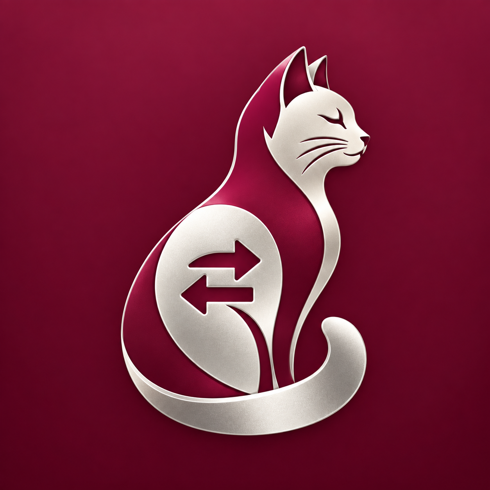
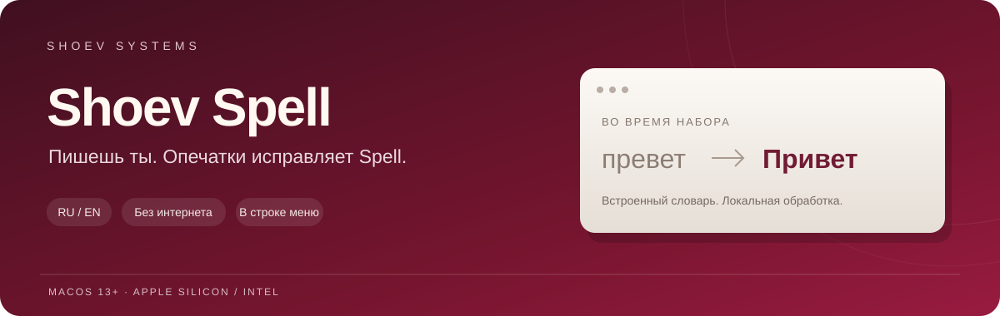

<div align="center">



<h3>SHOEV SYSTEMS</h3>

# Shoev Spell — исправление опечаток

Меньше опечаток. Больше внимания к тому, что пишешь.

[](#macos)
[](#macos)
[](https://github.com/TiDazai/Shoev-Spell/actions/workflows/tests.yml)
[](https://github.com/TiDazai/Shoev-Spell/releases/latest)

**[Скачать для Mac · DMG](https://github.com/TiDazai/Shoev-Spell/releases/latest/download/Shoev-Spell.dmg)** · [Что нового](CHANGELOG.md) · [Сообщить об ошибке](https://github.com/TiDazai/Shoev-Spell/issues/new/choose)

</div>



Shoev Spell исправляет русские и английские опечатки во время набора. Живёт в строке меню macOS и помогает со знаками препинания и заглавными буквами. В репозитории также есть [версия для Windows](windows/README.md).

Разработано компанией **SHOEV SYSTEMS**. Автор — **Shoev Timur (TiDazai)**.

Shoev Spell is an offline Russian and English spell checker and autocorrect app for macOS and Windows, made by SHOEV SYSTEMS.

Словарь встроен в приложение. Исправления работают без интернета, журнал хранится на вашем компьютере.

## Что умеет

- Исправляет простые опечатки по встроенному словарю. Если подходящих вариантов несколько и выбор неочевиден, оставляет слово как есть.
- Ставит запятые в знакомых конструкциях: например, при вводных словах, обращениях и перед некоторыми союзами.
- В macOS делает первое слово предложения заглавным при завершении слова пробелом или знаком препинания. Сам набор букв проходит без перехвата.
- В macOS пропускает Enter, Shift+Enter и Tab без исправлений и синтетического повтора. Отправку сообщения и перенос строки определяет редактор; автоматическая точка по Enter не добавляется.

Исправления, пунктуацию и заглавные буквы включаются отдельно через меню кошки. Там же можно открыть журнал, настроить автозапуск и исключить текущее приложение. Статус показывает, работает ли исправление, включена ли пауза или нужны разрешения.

С пунктуацией пока есть ограничения: она работает по набору правил и не всегда верно понимает смысл фразы. В сложных предложениях запятые лучше проверить самому. Приложение обрабатывает текущий набор, а не вычитывает весь открытый документ.

Защищённый ввод пропускается. Терминалы и некоторые редакторы кода по умолчанию исключены из обработки.

## SHOEV SYSTEMS

Приложения SHOEV SYSTEMS для работы с русским и английским текстом:

- **Shoev Spell** — исправление опечаток, заглавные буквы и помощь с русской пунктуацией.
- **[Shoev Switcher](https://github.com/TiDazai/Shoev-Switcher)** — автоматический переключатель раскладки RU ↔ EN: `ghbdtn` → `привет`.

Приложения самостоятельные и работают локально. В macOS при совместном использовании сначала обрабатывается неверная раскладка, затем — орфография. Spell не перехватывает первую букву слова.

Для исправлений поле должно предоставлять текст, положение курсора и возможность замены выделенного текста через «Универсальный доступ». Если поле этого не поддерживает, приложение пропускает исправление. Замена выполняется напрямую, без имитации буквенных клавиш и удаления слова клавишей Backspace. При удалении текста контекст сбрасывается; отслеживание возобновляется с нового слова. Выделенный текст и части уже существующего слова автоматически не капитализируются.

## Установка

### macOS

1. [Скачайте Shoev-Spell.dmg](https://github.com/TiDazai/Shoev-Spell/releases/latest/download/Shoev-Spell.dmg).
2. Откройте образ и перетащите Shoev Spell в «Программы».
3. Запустите приложение и выдайте запрошенные разрешения.

Одна сборка подходит для Apple Silicon и Intel. Нужна macOS 13 Ventura или новее.

При первом запуске понадобятся два разрешения macOS:

- **Мониторинг ввода** — чтобы приложение получало нажатия клавиш.
- **Универсальный доступ** — чтобы оно могло заменять набранный текст. В новых версиях macOS этот раздел может называться «Управление устройством и доступ к данным».

Оба находятся в «Системные настройки → Конфиденциальность и безопасность». Приложение повторно проверяет разрешения и возобновляет обработку после их выдачи.

Текущие публичные сборки не имеют нотариализации Apple. Если macOS блокирует открытие, используйте штатную кнопку «Всё равно открыть» в разделе «Конфиденциальность и безопасность».

### Windows

Исходники для Windows 10 и 11 x64 находятся в [`windows/`](windows/README.md). Если в выбранном релизе есть `Shoev-Spell-Windows-x64.zip`, распакуйте его и запустите `Shoev Spell.exe`; установка .NET не требуется. macOS и Windows используют один словарь, но отличаются поддержкой текстовых полей и правил пунктуации.

## Если исправление не срабатывает

Если исправления не работают, сначала проверьте, включены ли они в меню приложения. Затем проверьте разрешения. После замены сборки macOS иногда показывает включённый доступ, но продолжает его отклонять. В таком случае попробуйте выключить и снова включить разрешения для Shoev Spell, затем перезапустить приложение.

Попробуйте набрать `превет` и нажать пробел в обычном текстовом поле. Если ошибка возникает только в одном приложении, укажите его название и версию в [отчёте об ошибке](https://github.com/TiDazai/Shoev-Spell/issues/new/choose). Некоторые поля не предоставляют доступ к замене текста; в них Shoev Spell пропускает исправление.

## Сборка

Windows:

```powershell
dotnet publish windows/ShoevSpell.Windows/ShoevSpell.Windows.csproj -c Release -r win-x64 --self-contained true
```

macOS:

На Mac с установленными инструментами разработки Xcode выполните:

```bash
./scripts/setup-local-signing.sh
./scripts/build-app.sh
```

Готовое приложение появится в `dist/Shoev Spell.app`. Словарь собирается автоматически из частей, которые лежат в репозитории.

Первый скрипт создаёт постоянную локальную подпись для сборок на вашем Mac. Это помогает сохранять системные разрешения при обновлениях. Закрытый ключ хранится вне репозитория.

Чтобы упаковать приложение в DMG:

```bash
./scripts/create-dmg.sh
```

Проверить исправление слов и правила пунктуации:

```bash
swift test
```

[Архитектура](docs/ARCHITECTURE.md) · [Лицензия кода](LICENSE) · [Источники и лицензии словаря](LEXICON_LICENSES.md)

<div align="center"><sub>SHOEV SYSTEMS · Shoev Spell</sub></div>
